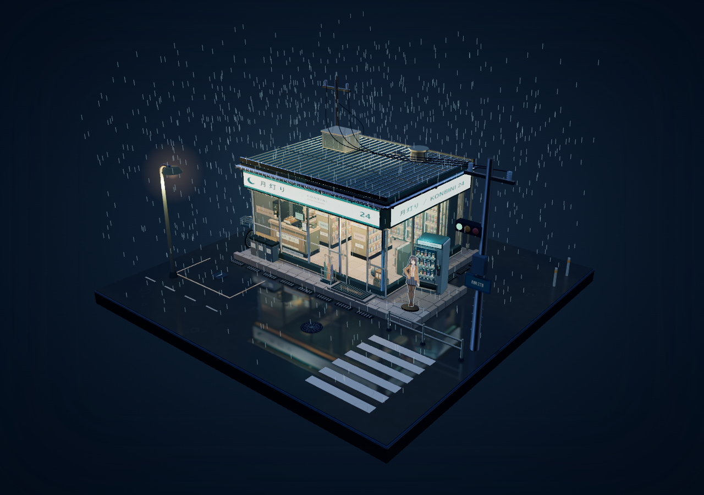

# 月灯り · 雨夜便利店

一个可离线打开的三维微缩街角：暖光便利店、持续降雨、积水反射、精细商品陈列，以及店旁亚克力立牌和可移动小圆球。采用卡通轮廓与柔和夜景配色，画面没有菜单或操作浮层。



## 在线打开

[直接进入雨夜便利店场景](https://2749111465lin-hue.github.io/yindaomayi/)

网站首页与离线单文件版本相同。GitHub Pages 从当前分支根目录发布，后续推送更新会自动重新部署。

## 打开场景

下载 [`rainy-night-konbini.html`](rainy-night-konbini.html)，双击后用现代桌面浏览器打开。引擎、代码和贴图都已内嵌，运行无需联网或安装依赖。

## 操作

| 操作 | 功能 |
| --- | --- |
| 鼠标左键拖拽 / 右键拖拽 / 滚轮 | 旋转 / 平移 / 缩放 |
| 触屏单指 / 双指 | 旋转 / 缩放和平移 |
| WASD 或方向键 | 相对视线移动小球 |
| Shift + 移动 / 空格 | 加速 / 小幅跳动 |
| 1 / 2 / 3（或 C） | 第一视角 / 街角全景 / 店内剖视 |
| Q / E | 第一视角转向 |
| R / 0 | 全景下切换屋顶 / 恢复初始位置和视角 |

小球可经过自动门进出便利店；墙壁和货架设有碰撞。详细操作见 [`操作说明.txt`](操作说明.txt)。

## 从源码构建

安装 Node.js 18 或更新版本，在本目录执行：

```sh
npm install
npm run build
```

构建会同时生成独立的 `rainy-night-konbini.html` 与 GitHub Pages 首页 `index.html`。主要源码为 `main.js`，店内、材质、灯光和店外细节分别位于 `interior.js`、`materials.js`、`look.js`、`exterior-detail.js`；`standee.js` 使用官方插画创建平面立牌。

依赖版本固定为 Three.js 0.170.0 与 esbuild 0.25.10。也可使用随仓库提供的 pnpm 锁文件安装依赖。

## 素材与参考

- 立牌插画来自用户指定的《青春ブタ野郎》官方角色图：[原图来源](https://ao-buta.com/tv/assets/img/chara/pc/02/img_chara_main-front.png)。图片版权归原权利人所有，第三方代码许可不涵盖该插画。
- 湿地面与后期渲染思路参考 [threejs-conference](https://github.com/ektogamat/threejs-conference)，卡通着色思路参考 [Three-js-Anime-Shader](https://github.com/ZaneAtega/Three-js-Anime-Shader)。场景与效果独立实现，未导入这些项目的模型或贴图资产。
- 第三方依赖的许可正文见 [`THIRD_PARTY_NOTICES.md`](THIRD_PARTY_NOTICES.md)。
